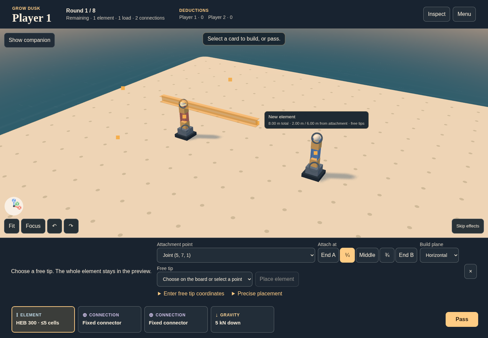

# Fixed interior frame collar evidence

Validated on 2026-11-15 against source commit `b1703d8927d54004b232100af1f3dbdf74dae81f` on `codex/shared-table-cantilevers`.

The [browser runner](../../../scripts/cantilever-browser.mjs) passed all **6 scenarios** in Linux Chromium **156.0.8078.79**, using genuine opening **seed 6** and `grow-dusk-release-2`. The [raw results](results.json) were copied unchanged from the completed run.

| Scenario | Input exercised |
| --- | --- |
| `pointer` | Pointer activation of the attachment, station, legal-tip and explicit connector controls. |
| `scene` | Actual canvas support/tip clicks through the production picker. Camera projection was observed only to locate fixture points on screen. |
| `precise` | Two endpoint coordinate fields while preserving the selected quarter contact. |
| `keyboard` | Keyboard activation and native select navigation. |
| `touch` | Touch-emulated button taps and native target selection on an 1180 × 820 landscape viewport. |
| `gpu-fallback` | The same placement controls while WebGL context creation was unavailable. |

Every scenario staged one frame from `(4,7,1)` to `(8,7,1)`, supported at its original `q1` station over `(5,7,1)`. It checked Unconnected before the explicit Fixed connector action and Attached afterward, exactly one element and one `q1` connection, unchanged draft after reload, a persistent 5 kN load at the free tip, completed End-turn assessment, concealed hands during private handoff, committed geometry and no horizontal page overflow. The runner also rejected unexpected browser exceptions. Non-touch scenarios used a 1440 × 1000 viewport.

The selected screenshot shows the production scene's whole-beam preview with the attachment pinned at 25%, a total span of 8 m and overhangs of 2 m / 6 m:



## Reproduction

From the repository root, with dependencies installed:

```sh
DOF_BROWSER_EXECUTABLE=/usr/bin/chromium node scripts/cantilever-browser.mjs
```

Omit `DOF_BROWSER_EXECUTABLE` to use Playwright's installed Chromium. `DOF_EVIDENCE_DIR` selects an output directory; the default is `/tmp/dof-cantilever-evidence`. The runner starts its own Vite server and writes JSON plus screenshots for each scenario. This directory retains one representative screenshot to keep repository evidence bounded.

## Additional validation and limits

- `npm test`: **606 passed, 9 skipped**. This includes the source-collar rules, exact placement, asymmetric numerical references, connector resultants, complete match/replay and old-save compatibility suites described in [cantilever placement](../../kb/cantilever-placement.md).
- The shared solver-contract and web production builds passed.
- The top-level `npm run build` could not rebuild Rust because Cargo was unavailable (`ENOENT`). No Rust sources changed; browser and numerical validation used the checked-in WASM module.

These results cover fixed interior sources on continuous frame members. Partial-lock, ball and elastic source collars, and cable/spring/assembly source collars, remain unavailable. Touch emulation is not hardware-touch or screen-reader acceptance. This run does not change the broader [release acceptance ledger](../../kb/criteria-ledger.md).
