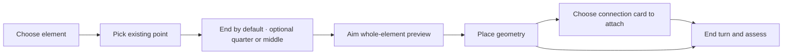

# Shared table cantilevers

## Evaluation

The repo already supports a conventional cantilever: place a member, attach one end with a connection card, and leave the other end free. The missing capability is placing a **whole new member over an attachment point at its own quarter or midpoint**, with material extending on both sides. Both deserve one placement workflow. The interaction and implementation below are proposals; this evaluation changes no gameplay.

| Arrangement | Current behavior | Evidence |
| --- | --- | --- |
| New beam attached at one end, opposite tip free | Supported. Snapping alone does not connect it. | `stageElement` / `stageConnection` in `game/turns.ts`; independent loose nodes in `game/turnAnalysis.ts`. |
| New beam end attached to an existing member's 25%, 50% or 75% port | Supported, including exact off-grid original ports. | `game/turnPorts.ts`; analytical continuity in `game/turnAnalysis.ts`; `game/quarterFrame.test.ts`. |
| New beam's own quarter or midpoint attached over an existing column tip | Unsupported. Geometry is rejected as a clash; the connection API can attach only ends A/B. | `contacts` in `game/materialClashes.ts`; `stageConnection` in `game/turns.ts`. |
| New beam crossing another member at arbitrary locations | Not a permitted connection. Physical clashes remain illegal. | Quarter-only interfaces and explicit contact rules in [placement criteria](placement-criteria.md). |

The active release is `/match` → `pages/ReleaseMatch.tsx` → `components/ReleaseBoard.tsx` → `viewer/Scene.tsx`, using the existing `game/turns.ts` authority. Secondary Shared table presets at `/play` use the same turn rules. The separate `multiplayer/domain` and `multiplayer/view` modules are not the release authority; changing their preview alone would not implement this feature. The alternate domain also restricts the connection source to an end in `multiplayer/domain/geometry.ts`.

### Why even a basic cantilever is hard to discover

- The release prompt says only “Choose the start point” and “Choose the end point.” It does not explain that the second point can be a free tip.
- `turnGuides.ts` highlights existing quarter ports and eligible connector ends. It does not show the reachable free-grid destinations for a selected element.
- After choosing a start, `sceneInteraction.ts` normally uses a vertical plane chosen from the camera direction. Horizontal placement requires Shift. There is no corresponding visible plane control in the release targeting bar.
- The growth candidate display in `Scene.tsx` explicitly excludes multiplayer. Precise placement is available, but requires thinking in endpoint coordinates.

## Proposed player workflow

Use the existing element card workflow for every arrangement. A separate cantilever tool or physics toggle is unnecessary.

1. **Choose an element card.** Prompt: “Choose an attachment point, or start on the grid.” Highlight existing tips and original quarter ports on either player's pieces. An attachment point need not already have a path to a foundation.
2. **Optionally change where it attaches.** Default to the near end with no extra confirmation, preserving the quick ordinary cantilever flow. Offer five labelled points on a small beam diagram: **End A · ¼ · Middle · ¾ · End B**. Selecting an interior point keeps that point pinned while the entire new member moves around it. Show this control only after choosing an existing interface; free placement retains the ordinary two-endpoint workflow.
3. **Aim and set reach.** Show a whole-element ghost, both tips, the attachment ring and nearby legal grid destinations. Start on a horizontal plane through the attachment, with visible **Horizontal / Vertical** controls. Changing the camera must not change the chosen plane. For Vertical, expose XZ/YZ selection; precise endpoints remain available for other orientations. The preview labels total length and both overhang lengths. Only legal reference geometry can be placed.
4. **Place, then explicitly attach.** Staging geometry shows a dashed ring labelled “Unconnected.” In the same targeting bar, offer compatible connection cards actually in the player's hand, for example **Attach with Fixed connector**. The player selects the card to spend it. Show its freedoms and remaining allowance. A connected ring and “Attached” appear only after that action succeeds. If no compatible card is available, explain why and retain the legal unconnected placement.
5. **End turn normally.** Use the existing assessment, deduction, repair and save flow. Geometry validity and graph reachability do not establish stability. Never label a preview “stable” before analysis.

Keep this in the existing compact targeting bar. Do not open another permanent panel. Tapping and keyboard activation must expose the same choices; hovering is optional. Escape returns one step before cancelling targeting, without discarding already staged cards. Cancel draft keeps its existing whole-draft meaning. A change to an unstaged attachment station does not consume a card; after staging, the existing draft cancellation rules apply.

### Example on the release board

Choose the first starting column's top at `(5,7,1)`, then choose **¼** on a four-unit horizontal beam. The preview runs from `(4,7,1)` to `(8,7,1)`: one unit behind the column and three beyond it. At the release scale, that is an 8 m member with 2 m and 6 m overhangs. Place it, then spend one compatible fixed connection at the quarter point. Both tips remain free; the beam stays one element card. The original column and its existing fittings remain unchanged.

For the conventional cantilever, keep **End A** selected and place `(5,7,1)` → `(9,7,1)`. It uses the same flow with no extra station choice. This arrangement already passes the current rules.

## Implementation boundaries

### Preserve exact geometry

For existing attachment position `O`, chosen new-member fraction `q ∈ {0, 1/4, 1/2, 3/4, 1}`, and full span vector `D`:

`A = O − qD`, `B = O + (1 − q)D`.

Validate the complete Euclidean span, both endpoints, board limits, printed orientations and physical reference solids. The maximum printed length applies to **A–B**, not just the projecting arm. Generate exact legal candidates; endpoints must still be grid locations or explicit permitted existing ports. Do not round either tip, move the pinned interface or add new off-grid endpoint rules implicitly. For example, a five-unit horizontal beam supported at its quarter over an integer-grid point produces off-grid tips; a four-unit span works. Empty candidate sets need an actionable explanation such as “Choose another span or attachment position.”

Store original parent ID and rational station. Analytical subdivision must not create new playable stations. Quarter-supported placement remains one parent with its original properties, loads and mass.

### Add a connection at an interior source interface

Today a stored connection identifies `memberId`, `end: a|b`, `jointId` and profile. Generalize the source to an original member interface, such as `{memberId, quarter: 0|1|2|3|4}`, with a persistent connector identity. The receiving joint retains its explicit identity; an existing quarter target retains its own parent/station identity. A read adapter maps historical A/B ends to 0/4. Do not infer target identity from coordinates or rewrite previously fitted column ends.

Extend the existing matching-freedoms rule to the new attachment. A setup column's existing fixed joint requires a compatible fixed connector. Being located over a column never grants a new foundation or direct ground fixity. An attachment uses one connection card and one connection allowance, regardless of whether its source is an end or interior station. Repeated connections at an occupied source interface remain illegal under the immutable-connector policy.

An intended **contact** must be stored separately from the fitted **connection**. Placement needs declared source/target interfaces so `materialClashes.ts` can allow the bounded fitting region before the connector is played. That fitting exception adds no stiffness. Check all material outside it; a generic crossing must not become legal because any two coordinates happen to match. Preserve neutral-object exclusions and the original clash checks for hollow sections and assemblies.

### Keep the through-member continuous

The internal quarter node belongs to one continuous beam. Its left and right analytical pieces must share all six internal DOFs even when the external connector releases a rotation.

For an **all-six-DOF fixed collar**, the quarter node can alias the existing receiving joint while keeping original IDs in provenance. This reuses current continuous subdivision and does not require a new Rust stiffness formulation. The collar still needs force/moment recovery from adjacent parent-segment actions and a capacity check of its own; accepting displacement and reactions alone is insufficient for scored release. Define whether a direct interface load acts on the source member or receiving joint before aliasing. Recover collar demand with that load convention, so a force applied directly at the source collar is not omitted or counted twice.

For **partial-lock, ball or elastic collars**, keep a private continuous node on the through-member and add a separate six-DOF relation to the receiving joint. Current solver models describe connections only at member ends (`packages/solver-contract/src/analysis.ts`, `crates/dof-solver/src/model.rs`), so the general relation requires contract and solver work. Merging the nodes would incorrectly lock released rotations. Releasing both analytical beam ends at the interior station would incorrectly cut the original beam's continuity. Do not use either shortcut or invent a short rigid beam as a fitting.

The same targeting concept can serve other families, but their physical laws still apply. An axial spring or cable does not acquire bending stiffness from this UI. Assembly targets must resolve to authored physical interfaces. Do not call every family a stable cantilever or silently convert a nonfixed card to fixed.

### Carry the attachment through the whole match

| Boundary | Required update |
| --- | --- |
| `components/ReleaseBoard.tsx`, `ReleaseTargets.tsx`; `viewer/sceneInteraction.ts`, `scenePicking.ts`, `turnGuides.ts`, `turnPicking.ts` | Station selection, stable plane, whole-member preview, free destinations, exact target identity and contextual attachment action. Keep secondary Shared table controls aligned through shared targeting rules. |
| `game/turns.ts`, `turnPorts.ts`, `materialClashes.ts` | Source-interface connections, declared fitting contacts, legality, one-card consumption and receiving-joint compatibility. Revalidate at End turn. |
| `game/turnAnalysis.ts`; solver contract/adapters | Continuous parent subdivision, external collar relation, correct load targets and collar force/capacity recovery. Fixed aliasing is a bounded first implementation. |
| `game/connectivity.ts`, `turnEvidence.ts`, `turnIssues.ts`, `turnRepair.ts` | Source-port reachability; persistent collar identity in analysis, overload evidence, penalties and local repairs. Do not count a collar twice because it touches two segments. |
| `game/releaseSession.ts`, `releaseSave.ts`, `session.ts`, replay in `turns.ts` | Versioned events and deterministic replay. Preserve historical rules and saves. New attachment mechanics need a new supported ruleset/schema path, not changed meaning under `grow-dusk-release-1`. |
| Load resolution, public views and joint inspection | Resolve aliases without losing original stations; preserve setup/neutral load exclusions and private handoff; show actual connector freedoms at the source and receiving joint. |

Recommended sequence: first expose the already supported end cantilever interaction; then add fixed interior collars with complete provenance, scoring and replay; then add other collar laws through the general solver relation. Label each implemented capability accurately. The full request includes quarter/midpoint overhangs; the first interaction improvement alone does not complete it.

## Verification and completion gates

At repository baseline `39508f0`, five existing focused suites passed **52/52 tests**: `quarterFrame`, `releaseRules`, `materialClashes`, `sceneCandidates`, and `multiplayer/domain/domain`. The frame suite includes analytical cantilever displacement and reaction comparisons for five sections at all three original quarter stations. This validates existing behavior, not the proposed collar.

Run `node docs/evidence/cantilever-evaluation/probe.mjs` from the repo root for the current rule reproduction. It demonstrates that an end cantilever attaches with one connector and retains an independent free-tip node; the new beam over its own quarter at the starting column fails clash checking; an interior source is unavailable in the connection API. The probe reports observations and is not a release acceptance test.

Before shipping the extension, require:

- Normal pointer, keyboard and touch construction of an end cantilever and a new beam over its own 25%, 50% and 75% attachment. Include either player's structure and exact diagonal/off-grid target identity.
- Full-span limits, both board edges, unavailable exact grid spans, intended fitting contact, unintended intersections, occupied source interfaces and incompatible joint profiles. Camera orbit must not move the pinned station or plane.
- One element/one connection consumption, independent remaining allowances, absent connector cards, intentional unconnected placement, cancellation, reload during a draft, committed replay, private handoff and unchanged legacy saves.
- Independent numerical references for fixed collars under asymmetric loads on either side: signed support forces/moments, tip motion, continuous beam rotation and recovered collar demand. Symmetric loading alone can hide an incorrect hinge. Include the original column's flexibility in full-board fixtures; it is not a foundation at its top.
- For each additional collar law, verify independent beam/host rotations, free versus locked axes, elastic relative motion, instability, connector capacity, issue identity and local physical repair. Loads at a collar must follow the same alias and setup-load exclusion rules.

No new game interaction, connection law or scored capability is implemented by this document. Browser usability testing of the proposed flow remains part of implementation acceptance.
