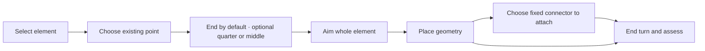

# Shared table cantilevers

## Implemented scope and versions

New Shared table matches use **`grow-dusk-release-2`**. A continuous frame can be placed with its own original **25%, 50% or 75% station** over an existing shared joint or permitted original quarter port, then attached there with one **Fixed connector**. Both projecting tips remain free. The beam stays one element card and the attachment spends one connection card. Ordinary one-end cantilevers and incoming ends attached to existing quarters remain available.

**Play** creates v2 matches at `/match`. **More modes → Shared table → Shared table · cantilevers** selects the same mechanics at `/play` and is the default for a fresh setup. Continue preserves the saved match's catalogue. The v2 decks reuse the exact v1 card printings and deterministic draw sequence; v1 saved matches retain `grow-dusk-release-1` mechanics and cannot acquire interior source attachments by replaying new events. Private headers identify the actual rules version and must match the saved turn.

| Arrangement | Current capability |
| --- | --- |
| Member connected at one end, opposite tip free | Available under the existing end-connection rules. |
| New end attached to another member's original quarter | Available under that target family's existing quarter law. |
| New continuous frame supported at its own quarter or midpoint | Available in v2 with a declared contact and a compatible fixed collar. |
| Partial-lock, ball or elastic connector at an interior source | Unavailable; the rule rejects it without spending the card. |
| Interior source on a cable, axial spring or assembly | Unavailable in this extension; use its supported end-attachment workflow. Existing quarter targets keep their existing family law. |
| Arbitrary undeclared material crossing | Illegal; a visible crossing does not establish a fitting or connection. |

The active authority remains `game/turns.ts`, presented through `ReleaseBoard` and `viewer/Scene`. The separate `multiplayer/domain` and `multiplayer/view` preview modules do not implement this v2 source-collar workflow.

## Player workflow

1. Select an element and choose an **Attachment point** in the scene or target list. Ordinary free placement can still start on the grid.
2. Keep the default **End A**, or optionally select **¼ · Middle · ¾ · End B** under **Attach at**. Interior choices appear for supported frame cards in v2 after choosing an existing interface. The selected original station stays pinned.
3. Choose a **Free tip**. The full element appears in the preview, with both endpoint markers, the attachment ring and valid destinations. The targeting bar shows whole length, endpoint coordinates and both overhang lengths for an interior station. **Build plane** defaults to **Horizontal**, with explicit **Vertical XZ** and **Vertical YZ** choices. Orbiting the camera does not select a different build plane.
4. **Place element** stages geometry. The contact remains **Unconnected**, with a dashed scene ring for an interior source. **Attach with Fixed connector** spends the named compatible hand card only after the player clicks it. The status becomes **Attached** after acceptance. A missing compatible card or exhausted connection allowance leaves the legal unconnected draft available.
5. **End turn** uses the existing assessment, deduction, repair and save flow. Legal placement, connection and foundation reachability do not promise structural stability.

The same controls support keyboard selection and coordinate fallback. **Enter free tip coordinates** derives the complete pinned member from a target tip. **Precise placement** accepts grid coordinates or named original ports for both endpoints and forwards the selected interior contact when an attachment station is active. The authority verifies that those endpoints meet the pinned station exactly. Without a selected interior contact, the form retains ordinary independent placement. Escape backs out of the current targeting operation before cancelling card selection; **Cancel draft** retains its existing whole-draft meaning. A hover is not needed to select a target or spend a card.

### Release-board example

Choose the first starting column's top at `(5,7,1)`, choose **¼**, and select free tip `(8,7,1)`. The beam spans `(4,7,1)` → `(8,7,1)`: one grid unit behind the column and three beyond it. At 2 m per unit, that is one 8 m member with 2 m and 6 m overhangs. Place it and explicitly attach the fixed connector. The original column and its fitted connections remain unchanged.

For an ordinary cantilever, keep **End A** and use `(5,7,1)` → `(9,7,1)`. It follows the same interaction without an extra station confirmation.

## Geometry, identity and physical behavior

`cantileverPlacement.ts` derives both tips from the pinned point and selected original fraction, then calls `stageElement` to validate the complete placement. The printed maximum applies to the full Euclidean span, including both overhangs. Both endpoints must remain valid grid positions or explicitly permitted named ports. Exact off-grid host quarters are preserved. Invalid reaches are rejected rather than moving the pin or rounding a tip into a legal placement. For example, a five-unit horizontal beam at its quarter over an integer-grid point has off-grid tips, while a four-unit span can fit exactly.

`AttachmentSite` retains the historical `a`/`b` end IDs and adds `q1`/`q2`/`q3`. The legacy connection field name `end` now carries one of those original sites. An element event records its optional `{quarter, target}` contact, and the placed member stores the corresponding `interiorTargets` identity. The contact declares the bounded fitting region for reference-solid clash checking. It adds no stiffness. Material outside that region still undergoes the existing physical clash checks.

Fitting the fixed collar aliases the continuous parent quarter node to the receiving joint for analysis. Both neighboring beam pieces preserve full internal continuity. No new member, hidden short rigid beam, ground restraint or foundation is introduced. Existing fittings remain immutable. Source and receiving-joint profiles must match through the explicit alias chain. One collar receives one persistent identity, such as `connection:port:3:1`, and one overload identity, such as `connection-overload:3:q1`.

The capacity check recovers the signed resultant of the adjacent parent segments, including loads and incoming fittings explicitly attached to the source port. A load applied directly to the receiving joint is not silently charged to the source collar. Nested source collars transfer their demand once; missing verified segment response or cyclic attribution withholds the capacity result. Member-level response still reports one physical parent.

Load targets retain their original physical identities. Alias resolution carries a source-port load to the analytical receiving joint without rewriting its history. A source aliased to an excluded setup or neutral joint remains excluded from player load targets. A loose end at coincident coordinates keeps its independent identity.

The structural snapshot records a collar explicitly with original parent, rational quarter, source/receiving joint IDs and the `fixed-interior-collar-1` interpretation. It does not disguise the collar as an original member end. Connectivity, issue comparison, inspection and local repair use the source station. The separate editor/OpenSees translation rejects an interior-collar request it cannot represent; it does not fabricate a different model.

## Verification and remaining scope

The focused regression suites cover:

- `cantileverRules.test.ts`: all three source quarters, declaration and exact coincidence, clashes, fixed-profile compatibility, immutable fittings, card consumption, cancellation, load exclusions, replay tampering and unchanged v1 mechanics.
- `cantileverPlacement.test.ts`: default end placement, pinned whole geometry, both board sides, full-span limits, stable planes, exact diagonal/off-grid host identities and unavailable source families.
- `interiorCollarAnalysis.test.ts` and `evaluator/collarCapacity.test.ts`: asymmetric loaded arms at all quarters, independent shear-flexible cantilever displacement references, signed reactions and collar force/moment, direct source versus receiving-joint loads, incoming branches, nested collars, explicit snapshot identity and unavailable-response behavior.
- `cantileverRelease.test.ts`: a genuine dealt v2 quarter-supported 5 kN match through all 16 turns, one card per physical play, unchanged starting fittings, Rust final-score provenance, complete private draft/final replay and v1 private-save preservation.
- `menu/startPlan.test.ts`: the v2 preset reaches the release board dimensions while Continue retains a historical match.

The [2026-11-15 integrated browser walkthrough](../evidence/cantilevers/README.md) passed **6/6 scenarios** in Chromium 156.0.8078.79 with genuine seed 6: pointer controls, actual scene picking, precise endpoint entry, keyboard input, touch emulation and unavailable-WebGL fallback. Each scenario staged one whole beam and one explicitly chosen `q1` fixed connector, reloaded the exact draft, placed a 5 kN tip load, completed assessment/private handoff, verified the committed geometry and checked horizontal overflow. The combined source recorded on local main at `149efc4` passed TypeScript, **869 tests with 12 skipped**, and shared-contract/web production builds. It preserves main `cca5702`'s evaluator and solver changes. The older feature-only 608-test run and its Cargo limitation remain historical evidence. See [recorded source revisions, raw results and reproduction](../evidence/cantilevers/README.md) and [integration validation](development-and-testing.md#cantilever-feature-and-main-integration--2026-11-15).

These browser results use Linux Chromium and touch emulation. Hardware touch, assistive technology and the broader release matrix remain governed by the [controls criteria](controls-camera-criteria.md) and [release ledger](criteria-ledger.md).

Partial-lock, ball and elastic **interior source** collars remain unimplemented. They require a separate six-DOF relation between the through-member's continuous private node and the receiving joint; plain node aliasing would incorrectly lock their released axes. Releasing both beam segments would incorrectly cut the parent's continuity. Axial-family and assembly source collars likewise require their own defined physical interfaces and validation. These limits do not remove existing end or target-quarter capabilities.

### Historical evaluation

At baseline `39508f0`, the existing five focused suites passed 52/52 tests, but own-quarter support was rejected as a clash. The [recorded observations](../evidence/cantilever-evaluation/observations.json) and [read-only probe](../evidence/cantilever-evaluation/probe.mjs) preserve that finding. The probe deliberately creates a **v1** match, so its rejection remains correct after v2 is added. It is historical evidence rather than a v2 acceptance test. The initial evaluation is retained in Git history at `8cdd5b6`.
